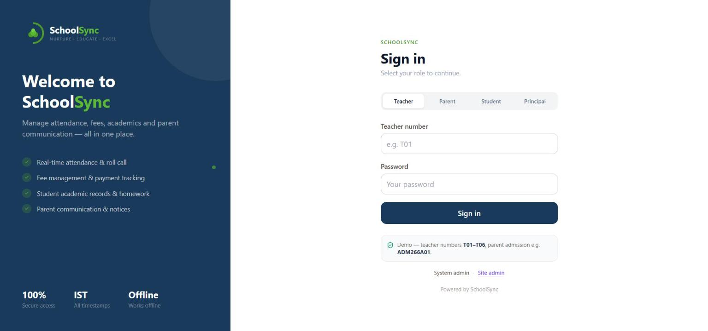
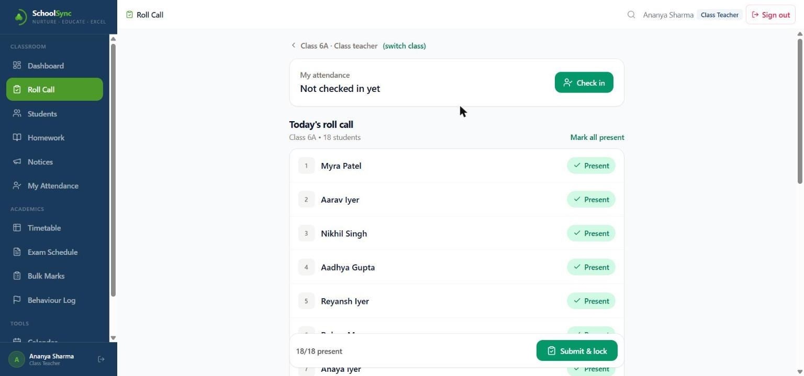
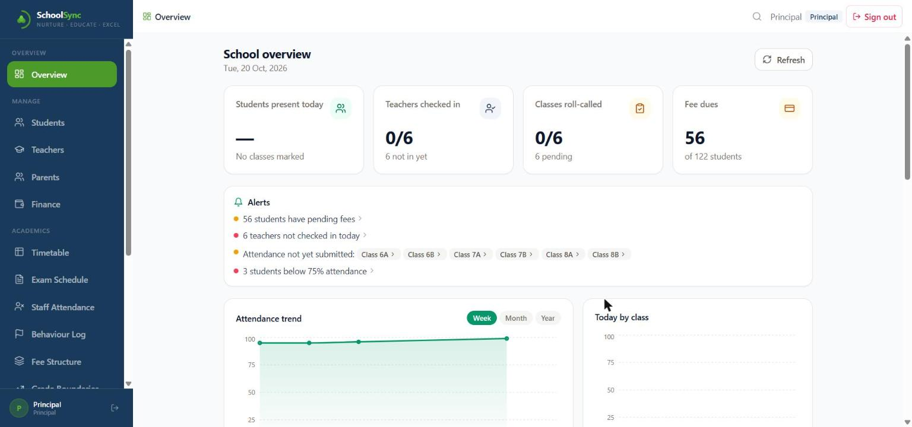

# SchoolSync: live demo

**[Open the live demo](https://amanksingh633.github.io/schoolsync-demo/)**

SchoolSync is a school management web app (installable PWA) for attendance, fees, academics,
notices and parent communication. This repository hosts a **static demo build** so you can try it
without installing anything.

| Sign in | Teacher roll call | Principal overview |
|---|---|---|
|  |  |  |

## How to try it

The demo seeds itself with synthetic data (about 120 students across six classes, six teachers).
Everything runs in your browser; nothing is sent to a server.

1. **Teacher:** open the *Teacher* tab, enter `T01`, and create any password on first sign-in.
   Pick *Class 6A* to take the roll call, then explore Students, Homework, Notices, Timetable,
   Bulk Marks and the Behaviour Log from the sidebar.
2. **Principal:** open the *Principal* tab and follow the first-setup prompt on screen to set a
   password. You get the school overview, attendance and fee trends, alerts, staff attendance,
   finance, fee structure and grade boundaries.
3. **Parent:** open the *Parent* tab and use the sample admission number shown on the sign-in
   screen.
4. **Admin views:** *System admin* and *Site admin* links sit under the sign-in form (the site
   admin controls school name and per-module feature toggles).

Your changes are stored in your browser's local storage, so they stay on your device. Clearing
site data resets the demo.

## What's inside

React, Vite, Tailwind CSS and Recharts; offline-capable PWA with a service worker; optional
Firebase Firestore storage for shared multi-device use (switched off in this build). Records are
split across several documents to support 2,000+ students.

## Notes

- This is a demo build of a prototype. Sign-in is checked in the browser and is **not suitable for
  real student or financial data**; please don't enter any.
- The application source lives in a private repository. For contact details, see my
  [GitHub profile](https://github.com/amanksingh633).
- Built with AI assistance (Claude).
